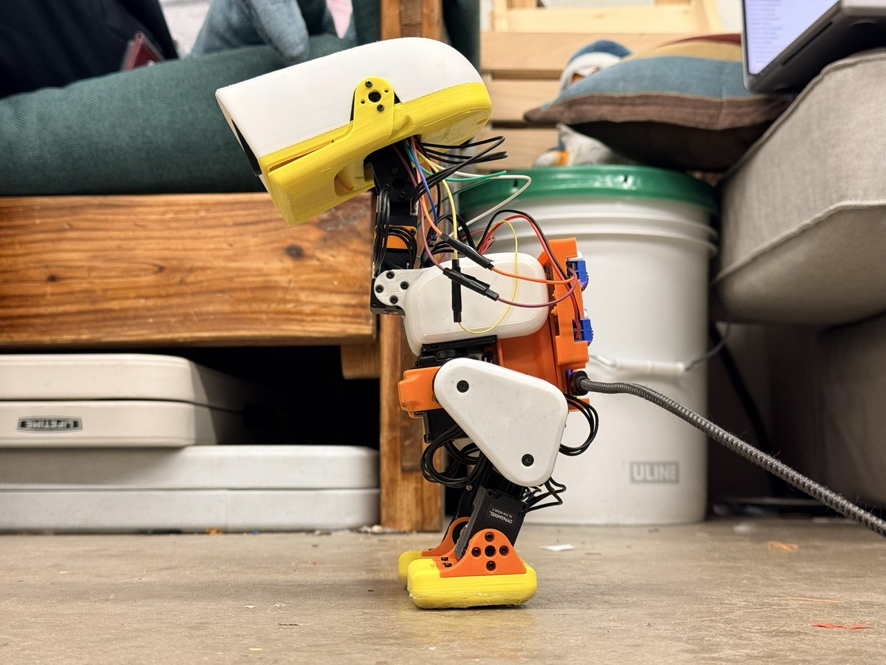

# CMU MicroDuck

The first hand-built [MicroDuck](https://github.com/pollen-robotics/microduck) at Carnegie Mellon: a 15-servo walking duck with a head that senses touch, which the official robot does not. Built at the [CMU Robotics Club](https://roboticsclub.org) between 2026-09-30 and 2026-10-23 after Pollen Robotics' open-source design and [AI-FanGe's build tutorial](https://github.com/AI-FanGe/Microduck-build-tutorial). This repository holds everything needed to reproduce the robot exactly as it stood on 2026-10-23, including the software that stands and walks it: a 3D printer, the parts in `BOM.md` and a Mac are enough.

## The robot in five blocks

**[1. Printing](1-printing/)**: the body is AI-FanGe's community part set plus 34 parts of our own (a rear converter box, a head cap and face for the Radxa board, split ankles with slip-fit feet and bicycle-inner-tube soles, a one-piece right lower-leg link, a battery backpack), in colour scheme C: white shells, thighs and head cap, yellow lower head and feet, orange pack and ankles, black links. `1-printing/PARTS.md` lists every STL with its print pose and reason; `PLATES.md` points at the sliced plates for a Bambu X1C or an Elegoo Centauri Carbon, published as release assets.

**[2. Servos and OpenRB](2-servos-openrb/)**: 15 ROBOTIS XL330-M288-T in one chain on an OpenRB-150 running our `openrb_dual_host` firmware, which serves a Mac over USB and the head computer over the J12 UART at 500 kbaud. The page gives the IDs and roles, the cable chain, the scripts that assign IDs, check voltage limits, write the battery Shutdown value and check the hip-yaw horn, this build's joint signs, and the one safe way to flash the board.

**[3. Brain and senses](3-brain-and-senses/)**: a Radxa Cubie A7Z (Allwinner A733) in the head runs the 50 Hz control loop, the policy and the camera. A BNO085 IMU at 50 samples per second on an engine-mode TWI7 overlay, a MAX98357A amplifier and speaker behind a -3 dB software ceiling, a Seeed XIAO ESP32-S3 reading five copper touch pads in the cap over I2C, and the Radxa Camera 13M 214 in the eye. Pin map, OS image, overlays, services, and the thermal limit that caps a session at about 30 minutes.

**[4. Power](4-power/)**: route A, in daily use: a 20 V USB-C PD source (a 20 V 5 A charger or a Xiaomi 212W power bank) through an Adafruit 5991 decoy into two XL4015 converters, 7.0 V to the servos and 5 V to the A7Z. Route B, designed and bought, backpack being built, not yet installed: a Tattu 2S 650 mAh LiPo straight to the servos and a DFR1202 making 5 V, swapped in with two plugs.

**[5. Assembly](5-assembly/)**: the step-by-step build guide (11 chapters, 82 steps, a 3D view per step) and the bring-up pages for the head wiring, antenna, touch pads and battery wiring, all self-contained HTML under [`docs/`](docs/index.html).

**[6. Run](6-run/)**: the runtime (`walk_wired.py` and its closure) that reads servos and IMU, runs Pollen's 61-input ONNX policies and writes goals at 50 Hz, with the heading hold, the graded hold from the touch pads, the quack, the jaw, and the safety guards; a fetch script for Pollen's policy files with their hashes; and the first-run checklist.

`BOM.md` at the root is the bill of materials, generated from the project's procurement records by `scripts/build_bom.py`.

## What it does today

It stands and walks on Pollen's official policies (`walk61`, `stand61`, `groundpick61`) at 0.25 m/s, walks straight and arcs on command with an IMU heading hold, stops and holds when a hand grips its head and stands again when set down (6 of 6 lifts on 2026-10-23), quacks with its jaw moving, streams the duck's-eye view from the head camera, and records itself with a 10 Hz flight recorder on the board and per-tick logs. First free stand 2026-10-13, first walks 2026-10-16, A7Z head since 2026-10-18, untethered on a power bank 2026-10-23.

## Known limits

The A7Z overheats in the closed head: 85 C after five minutes, both CPU clusters capped at 416 MHz, the loop down from 50 Hz to about 36 to 42 Hz, resets near 90 C, and the walking policy diverges at 36 Hz; about 30 minutes of running per session before the head must cool. The robot drifts left while walking (the left knee gives under load, so left stance lasts twice as long); the heading hold cancels it on straight walks, but right arcs stay slow. A 20 V 3 A charger is not enough power; 5 A is. The battery route has not been run. The camera's target detector was calibrated on the earlier Raspberry Pi camera and needs recalibration on the Radxa camera. Falls still happen.

## How to reproduce it

1. Buy the parts in `BOM.md`; the two ROBOTIS OMX-AI kits supply the servos, the OpenRB and the XL4015 modules.
2. Print `1-printing/` (the plates from the release assets, or the STLs).
3. Set the servos up and flash the OpenRB as in `2-servos-openrb/`.
4. Write the A7Z card, add the overlays and wire the head as in `3-brain-and-senses/` and `docs/A7Z-PINS.html`.
5. Build the power route A converter box as in `4-power/`.
6. Assemble with `docs/MICRODUCK-BUILD.html`.
7. Install the runtime and walk through the first-run checklist in `6-run/`.

## Licenses

Our files (documents, scripts, firmware changes, our printed parts) are under the MIT License (`LICENSE`). AI-FanGe's print set in `1-printing/community/` is MIT (`1-printing/community/LICENSE-AI-FanGe`). The OpenRB sketch is derived from ROBOTIS's `usb_to_dynamixel` example (Apache-2.0). Pollen Robotics' MicroDuck design, training environment and policies are theirs under the terms of their repositories (`microduck` and `microduck_rl` Apache-2.0, meshes CC BY-NC-SA 4.0; the simulator Space states Apache-2.0 for its app code); the policy ONNX files are therefore not copied here, and `6-run/fetch_policies.sh` downloads the exact files with their hashes. `6-run/.../microduck_rt/constants.py` carries its own GPL-3.0-or-later header from its author.

## Related

- Training repository (Pollen's `develop` branch plus our `cmu/` layer: as-built model, sim check, runtime, fine-tuning): [github.com/qilinxiaoxiang/microduck_rl](https://github.com/qilinxiaoxiang/microduck_rl)
- Project page: [shawnxiang.com/microduck](https://shawnxiang.com/microduck)
- Contact: Shawn Xiang, shawn.xiang2@gmail.com

## Build log on LinkedIn

- [2026-10-13: Meet CMU's first (?) Microduck. Half-built for now.](https://www.linkedin.com/feed/update/urn:li:activity:7515635733777551360/)
- [2026-10-16: Learning to walk.](https://www.linkedin.com/feed/update/urn:li:activity:7516994475253059584/)
- [2026-10-23: My handmade microduck can finally walk and quack!](https://www.linkedin.com/feed/update/urn:li:activity:7519503040069021697/)

## Acknowledgements

Pollen Robotics for the MicroDuck design, the training environment, the simulator and the policies. AI-FanGe for the Microduck-build-tutorial (MIT) and the Raspberry Pi runtime this build started from. The CMU Robotics Club for the printers, tools and parts drawers.
